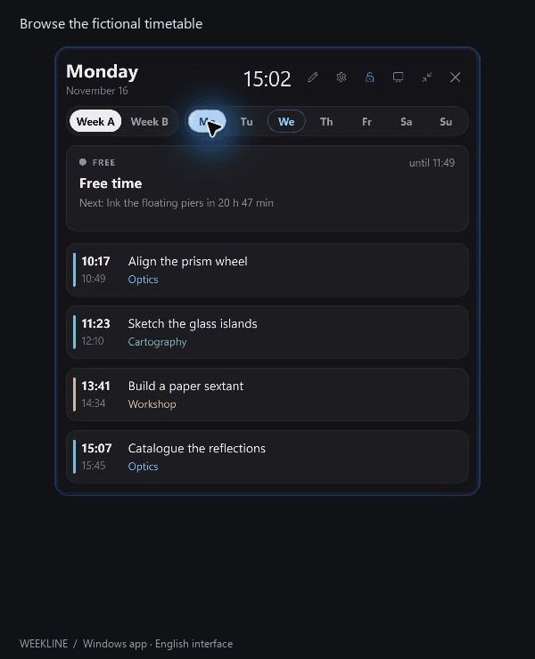
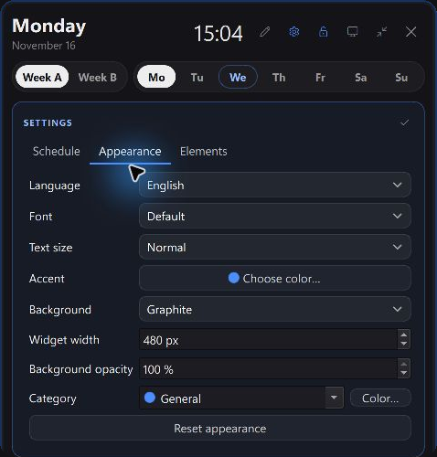
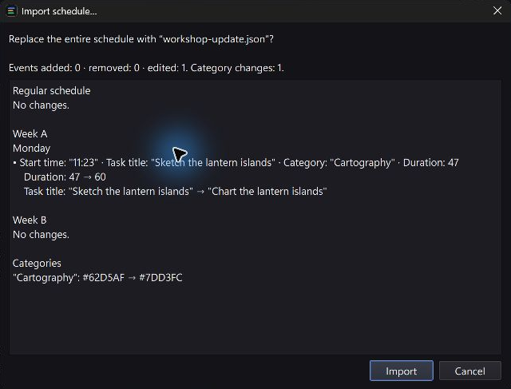
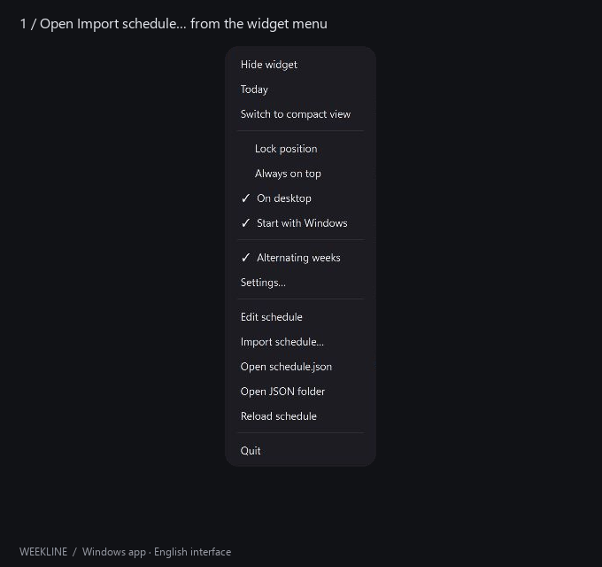

# Weekline

A desktop schedule widget that shows what’s on now, how much time is left, and what comes next across alternating weeks.


*The packaged Windows app with a fictional Glass Islands timetable. The interface supports English and Russian; event titles, category names and custom week names keep your original text.*

## Overview

Weekline sits on your Windows desktop and follows a repeating timetable. Use one schedule every week, or keep separate A and B weeks for a rotating routine. A slim view keeps the current activity and its countdown visible when you need the desktop space.

<details>
<summary>Watch the week switch, inline editor and compact view</summary>



</details>

## Features

- Follow the active time block, see progress through it and read the next activity during a gap.
- Switch between **Русский** and **English** in **Settings → Appearance → Language**. The interface updates immediately and remembers the choice after a restart.
- Browse seven or fourteen days. Name each week, choose the current one and let the widget alternate on Mondays.
- Double-click a card to edit its time, title, category or duration. Add and delete slots, or copy a day to the other week.
- Edit the local JSON in a text editor. The file watcher reloads saved changes and reports malformed files in the widget.
- Choose **Import schedule…** from the widget menu to compare a JSON file with the regular timetable, both alternating weeks and category colors. Choose **Import** to save the replacement or **Cancel** to keep your schedule.
- Choose desktop or always-on-top placement, lock the position, hide the widget in the tray or enable Windows sign-in startup.
- Adjust the width, density, fonts, colours and opacity. The compact view can be expanded with a double-click.

## Getting started

### Download for Windows

[Download ScheduleWidget.exe for Windows x64](https://github.com/reeesx3/weekline/releases/latest/download/ScheduleWidget.exe). Save it in a writable folder and double-click it. Python is included. On first launch, the widget creates the fictional starter schedule beside the executable.

### Run from source

On Windows, install 64-bit Python 3.12 or later with the Python launcher, then download and extract the repository or clone it. Open PowerShell in the project folder and run:

```powershell
py -m venv .venv
.\.venv\Scripts\python.exe -m pip install -r requirements.txt
.\.venv\Scripts\python.exe widget.py
```

Use a folder you can write to. On first launch, Weekline copies the bundled example to `schedule.json` and saves preferences in `config.json`. Subsequent launches read your local files. Both live beside the script, or beside the executable in a packaged installation.

## Usage

Select Monday in week A to explore the fictional Glass Islands workshop. Double-click **Sketch the glass islands** to change the title or its duration. The editor saves your changes to the local schedule.

| While the widget has focus | Action |
| --- | --- |
| ← / → | Browse the previous or next day |
| W | Switch between A and B in two-week mode |
| Home or T | Return to today |
| Ctrl+E / Esc | Toggle the editor / close the open panel |
| Ctrl+Q | Save and quit |

## Configuration

The gear opens schedule and appearance settings. Select the current A or B week if the rotation starts on a different week from the default. The app stores the reference Monday in `config.json`.

### Interface language

Open the gear, select **Appearance**, then choose **English** or **Русский** under **Language**. In Russian, the path is **Настройки → Оформление → Язык**. Dates, weekdays, menus, tooltips, settings and dialogs follow the selected language immediately. Your schedule text and any unfinished event edit stay intact. The choice is saved as `language` (`en` or `ru`) in `config.json`; existing installations without this key keep Russian.



### Import with a preview

Right-click the widget and choose **Import schedule…**, then select a JSON file. The preview compares the regular schedule, both alternating weeks and category colors. It lists added, removed and edited events, including changes to the order of events starting at the same time. Counts cover all three timetables, so a shared event can appear more than once.

Choose **Cancel** to keep the current schedule or **Import** to replace it with the previewed data. The imported schedule is saved beside the executable and survives a restart. If the current file changes while the preview is open, Weekline asks you to review an updated comparison. Invalid files and failed saves leave the existing file intact.



<details>
<summary>Watch a JSON import preview and confirmation</summary>



</details>

For a custom timetable, edit `schedule.json`. The following complete example creates a single recurring workshop. On loading a file with only `days`, Weekline seeds both A and B from those days. Each schedule can then be edited independently.

```json
{
  "categories": {"Workshop": "#F8B86D"},
  "days": {
    "mon": [
      {"time": "13:41", "title": "Build a paper sextant", "category": "Workshop", "duration": 53}
    ]
  }
}
```

Use `mon` through `sun` for days and local 24-hour times for starts. A positive `duration` is measured in minutes and is capped at the next start. Without a duration, a slot runs until the next one that day, the first slot tomorrow, or midnight if tomorrow is empty. For alternating timetables, put day maps under `weeks.a` and `weeks.b`. When `days` is absent, the first available week also seeds single-week mode. See the [bundled example](schedule.example.json).

## Tech stack

Python handles schedule parsing, calendar arithmetic and atomic saves. PySide6 Essentials provides Qt Widgets, timers, file watching and the tray. The Windows desktop layer uses Win32 through `ctypes`, and optional sign-in startup uses the current user's registry. PyInstaller builds the standalone executable.

## Project structure

```text
widget.py                     Application, schedule model and Qt interface
translations.py               English and Russian interface text and formatting
schedule_diff.py              Import comparison for schedules and category colors
schedule.example.json         Read-only starter timetable
test_widget.py                Regression tests with temporary data folders
requirements.txt              Runtime dependency
build.bat                     Windows packaging entry point
docs/images/                  App icon, screenshot and recorded UI states
.github/workflows/checks.yml  Windows test and packaging job
```

## Development

From the setup above, run the checks in PowerShell:

```powershell
.\.venv\Scripts\python.exe -m pip check
.\.venv\Scripts\python.exe -m compileall -q widget.py translations.py schedule_diff.py test_widget.py
$env:QT_QPA_PLATFORM = "offscreen"
.\.venv\Scripts\python.exe -m unittest -v
Remove-Item Env:QT_QPA_PLATFORM
```

To build a windowed executable, make sure `python` is on PATH, then run:

```powershell
.\build.bat
```

The script creates a separate build environment, checks dependencies and source compilation, and writes `dist/ScheduleWidget.exe`. Close an existing copy running from `dist` before building and back up its executable and local data. Copy just the executable to a writable folder to try a fresh install. The binary bundles the fictional example, the interface and comparison modules, and Qt translations. Local schedules, settings and generated builds are ignored by Git.

For window-based capture or assistive tools, run `ScheduleWidget.exe --window` (or `python widget.py --window`). This gives the widget a normal taskbar window for that session. Use a separate folder with fictional data for screenshots; do not copy personal schedules into documentation.

The Windows CI job runs dependency checks, compilation, the full offscreen regression suite and packaging. Its artifact is a build download, not a GitHub release. After the checks pass and the packaged UI has been verified, publish `ScheduleWidget.exe` as an asset of the latest release so the download link above stays current. See [release verification](docs/release-checklist.md).

## Contributing

For a bug report, include your Windows and Python versions, the steps to reproduce it and a small fictional timetable. Screenshots from the bundled demo make UI issues easier to reproduce. For a pull request, describe the user-visible change and run the regression suite above.

## License

Weekline’s source and original assets are available under the [MIT License](LICENSE). Qt, PySide6 and the packaging tools retain their respective upstream licenses.
