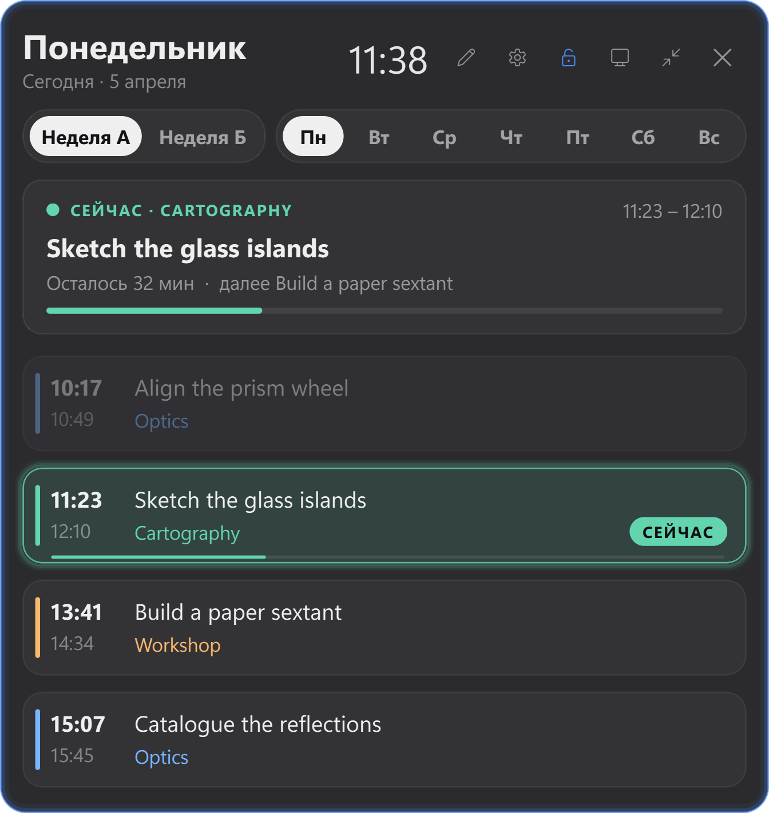

# Weekline

A desktop schedule widget that shows what’s on now, how much time is left, and what comes next across alternating weeks.




*The running widget with the fictional Glass Islands timetable. The interface is in Russian. Event titles and category names accept Unicode.*

## Overview

Weekline sits on your Windows desktop and follows a repeating timetable. Use one schedule every week, or keep separate A and B weeks for a rotating routine. A slim view keeps the current activity and its countdown visible when you need the desktop space.

<details>
<summary>Watch the week switch, inline editor and compact view</summary>


</details>

## Features

- Follow the active time block, see progress through it and read the next activity during a gap.
- Browse seven or fourteen days. Name each week, choose the current one and let the widget alternate on Mondays.
- Double-click a card to edit its time, title, category or duration. Add and delete slots, or copy a day to the other week.
- Edit the local JSON in a text editor. The file watcher reloads saved changes and reports malformed files in the widget.
- Choose desktop or always-on-top placement, lock the position, hide the widget in the tray or enable Windows sign-in startup.
- Adjust the width, density, fonts, colours and opacity. The compact view can be expanded with a double-click.

## Getting started

On Windows, install 64-bit Python 3.12 or later with the Python launcher, then download and extract the repository or clone it. Open PowerShell in the project folder and run:

```powershell
py -m venv .venv
.\.venv\Scripts\python.exe -m pip install -r requirements.txt
.\.venv\Scripts\python.exe widget.py
```

Use a folder you can write to. On first launch, Weekline copies the bundled example to `schedule.json` and saves preferences in `config.json`. Subsequent launches read your local files. Both live beside the script, or beside the executable in a packaged installation.

## Usage

Select Monday in week A to explore the fictional Glass Islands workshop. Double-click **Sketch the glass islands** to change the title or its duration. The editor saves your changes to the local schedule.

| While the widget has focus | Action |
| --- | --- |
| ← / → | Browse the previous or next day |
| W | Switch between A and B in two-week mode |
| Home or T | Return to today |
| Ctrl+E / Esc | Toggle the editor / close the open panel |
| Ctrl+Q | Save and quit |

## Configuration

The gear opens schedule and appearance settings. Select the current A or B week if the rotation starts on a different week from the default. The app stores the reference Monday in `config.json`.

For a custom timetable, edit `schedule.json`. The following complete example creates a single recurring workshop. On loading a file with only `days`, Weekline seeds both A and B from those days. Each schedule can then be edited independently.

```json
{
  "categories": {"Workshop": "#F8B86D"},
  "days": {
    "mon": [
      {"time": "13:41", "title": "Build a paper sextant", "category": "Workshop", "duration": 53}
    ]
  }
}
```

Use `mon` through `sun` for days and local 24-hour times for starts. A positive `duration` is measured in minutes and is capped at the next start. Without a duration, a slot runs until the next one that day, the first slot tomorrow, or midnight if tomorrow is empty. For alternating timetables, put day maps under `weeks.a` and `weeks.b`. When `days` is absent, the first available week also seeds single-week mode. See the [bundled example](schedule.example.json).

## Tech stack

Python handles schedule parsing, calendar arithmetic and atomic saves. PySide6 Essentials provides Qt Widgets, timers, file watching and the tray. The Windows desktop layer uses Win32 through `ctypes`, and optional sign-in startup uses the current user's registry. PyInstaller builds the standalone executable.

## Project structure

```text
widget.py                     Application, schedule model and Qt interface
schedule.example.json         Read-only starter timetable
test_widget.py                Regression tests with temporary data folders
requirements.txt              Runtime dependency
build.bat                     Windows packaging entry point
docs/images/                  App icon, screenshot and recorded UI states
.github/workflows/checks.yml  Windows test and packaging job
```

## Development

From the setup above, run the checks in PowerShell:

```powershell
.\.venv\Scripts\python.exe -m pip check
.\.venv\Scripts\python.exe -m compileall -q widget.py test_widget.py
$env:QT_QPA_PLATFORM = "offscreen"
.\.venv\Scripts\python.exe -m unittest -v
Remove-Item Env:QT_QPA_PLATFORM
```

To build a windowed executable, make sure `python` is on PATH, then run:

```powershell
.\build.bat
```

The script creates a separate build environment and writes `dist/ScheduleWidget.exe`. Copy just the executable to a writable folder to try a fresh install. The binary bundles the fictional example. Local schedules, settings and generated builds are ignored by Git.

## Roadmap

- Add English interface strings alongside Russian.
- Add a preview of schedule changes before importing a JSON file.

## Contributing

For a bug report, include your Windows and Python versions, the steps to reproduce it and a small fictional timetable. Screenshots from the bundled demo make UI issues easier to reproduce. For a pull request, describe the user-visible change and run the regression suite above.

## License

Weekline’s source and original assets are available under the [MIT License](LICENSE). Qt, PySide6 and the packaging tools retain their respective upstream licenses.
